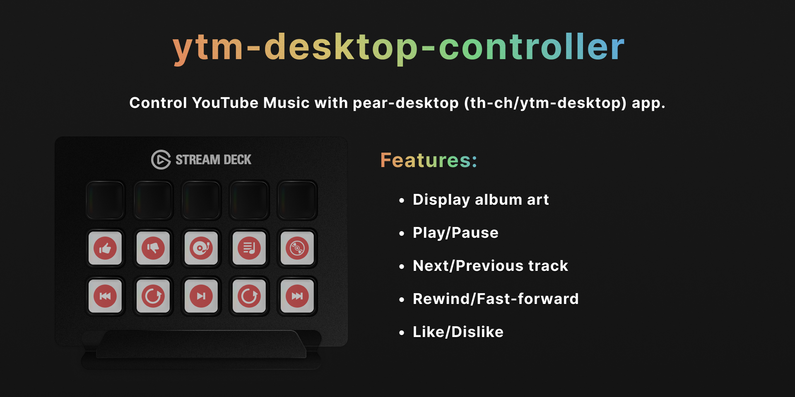

# ytm-desktop controller



This streamdeck plugin allows you to control YouTube Music with [pear-desktop](https://github.com/pear-devs/pear-desktop) (previous name: th-ch/ytm-desktop). 

[](https://marketplace.elgato.com/product/ytm-desktop-controller-7dfe9fc1-80a9-44e3-80c5-4cf456b74a2b)
[](https://www.buymeacoffee.com/yate)
[](https://github.com/tuat-yate/ytm-desktop-controller/stargazers)
[](https://github.com/tuat-yate/ytm-desktop-controller/watchers)

> [!WARNING]
> **Known issue: for some users, Previous / Next, Like / Dislike and Set Volume do nothing.**
> This is a bug in pear-desktop, not in this plugin: the API Server accepts these requests but the app does not act on
> them, so the keys show no error. For the same reason, Add Track / Playlist to Queue still queues the songs, but does
> not jump to them when something is already playing. Toggle Play, Go Forward / Go Back and Artwork Preview still work.
> It is tracked upstream in [pear-devs/pear-desktop#4728](https://github.com/pear-devs/pear-desktop/issues/4728)
> (see also [#6](https://github.com/tuat-yate/ytm-desktop-controller/issues/6)). This notice will be removed once a
> pear-desktop release fixes it.

## Setup

> [!IMPORTANT]
> This plugin requires **pear-desktop v3.11.0 or later** (verified with v3.12.0), with its **API Server** plugin
> enabled and set to **no authorization**. Nothing works without it — the keys show a red **Setup** warning while the
> API cannot be reached.
>
> On older builds the keys still work, but Like / Dislike cannot show whether the current song is rated: the
> `/like-state` endpoint was added in v3.11.0.

1. Install [pear-desktop](https://github.com/pear-devs/pear-desktop) (v3.11.0 or later)  
    Please refer [pear-desktop installation guide](https://github.com/pear-devs/pear-desktop?tab=readme-ov-file#download).
2. Set API Plugin on pear-desktop  
    Please click `Plugins -> API Server [beta]`, then, set `Plugins -> API Server [beta] -> Authorization strategy -> No authorization`.  
    Note: Default port number of API is set to `26538` (you can check it in `Plugins -> API Server [beta] -> Port`). 

3. Install Streamdeck Plugin [here](https://marketplace.elgato.com/product/ytm-desktop-controller-7dfe9fc1-80a9-44e3-80c5-4cf456b74a2b)

### Installing a Beta build (`.streamDeckPlugin`)
Pre-release (beta) builds are published as a `.streamDeckPlugin` file on the [GitHub Releases](https://github.com/tuat-yate/ytm-desktop-controller/releases) page, so you can test fixes before they reach the Marketplace.

1. Make sure the Stream Deck app is installed and running.
2. Download the `.streamDeckPlugin` file from the [latest release](https://github.com/tuat-yate/ytm-desktop-controller/releases).
3. Double-click the downloaded file. The Stream Deck app shows an install prompt — click **Install**.
4. The action group **ytm-desktop controller (Beta)** appears in the actions list.

> [!NOTE]
> Installing a beta build replaces the Marketplace version (they share the same plugin ID). You can reinstall the Marketplace version anytime to go back.

For the general procedure of installing a downloaded plugin, see Elgato's official guide: [Stream Deck — Download and use Plugins](https://help.elgato.com/hc/en-us/articles/33589587352337-Elgato-Stream-Deck-Download-and-use-Plugins).

## Actions
- [Base Arguments](#base-arguments)
- [Add Playlist to Queue](#add-playlist-to-queue)
- [Add Track to Queue](#add-track-to-queue)
- [Artwork](#artwork)
- [Go Forward](#go-forward)
- [Go Back](#go-back)
- [Toggle Play](#toggle-play)
- [Next](#next)
- [Previous](#previous)
- [Like](#like)
- [Dislike](#dislike)

---
  
### Base Arguments
These options are shared by every action that can display the now-playing artwork (**Artwork**, **Add Track to Queue**, **Add Playlist to Queue**, **Toggle Play**, **Next**, **Previous**). For example, enabling them on **Toggle Play** gives you a single key that shows the album art (with track info / progress) and toggles play/pause when pressed.

| Argument | Description |
|---|---|
| `Port` | Port number of the API. Default is `26538`. |
| `Show Now-playing Artwork` | Show artwork if play. This option will save when the streamdeck is restarted. Please restart or page switch to apply the setting.  |
| `Show Track Info` | Overlay the now-playing text (e.g. title / artist) on top of the artwork. Long text scrolls automatically. Requires `Show Now-playing Artwork`. |
| `Text Template` | The text shown when `Show Track Info` is enabled. Supports the tokens below. Defaults to `{title} - {artist}`. Disabled while `Show Track Info` is off. |
| `Show Progress Bar` | Show a green playback progress bar along the bottom edge of the artwork. Requires `Show Now-playing Artwork`. |

#### Text Template tokens
You can freely combine the following tokens (plus any literal text) in `Text Template`:

| Token | Replaced with |
|---|---|
| `{title}` | Track title |
| `{artist}` | Artist name |
| `{album}` | Album name |

Examples:
- `{title} - {artist}` → `Bohemian Rhapsody - Queen`
- `{artist}: {title}` → `Queen: Bohemian Rhapsody`
- `♪ {title}` → `♪ Bohemian Rhapsody`

### Add Playlist to Queue
Add a YouTube Music playlist to the queue. 
> [!NOTE]
> The playlist that you want to play must be shared as `Public` or `Unlisted`. 

| Argument | Description |
|---|---|
| `Playlist Id` | The ID of the playlist. If the shared link is `https://music.youtube.com/playlist?list=abcde`, `Playlist Id` is `abcde`. |
| `When pressed` | What the key does with the queue — see [When pressed](#when-pressed). |
| `Shuffle` | Shuffle the playlist before adding to the queue. |

### Add Track to Queue
Add a YouTube Music track to the queue. 

| Argument | Description |
|---|---|
| `videoId` | The ID of the video. If the music link is `https://music.youtube.com/watch?v=abcde&...`, `videoId` is `abcde`.|
| `When pressed` | What the key does with the queue — see [When pressed](#when-pressed). |

#### When pressed
Both queue actions share this setting, which decides what happens to the queue you already have.

| Option | Behaviour |
|---|---|
| `Add to the end of the queue` (default) | Appends to the queue and leaves playback alone. Starts playing only when nothing is playing. |
| `Play now (replace the queue)` | Clears the queue first, then plays the selected track / playlist from scratch. |
| `Play next (keep the queue)` | Inserts right after the current song and plays it immediately. The rest of the queue is kept. |

### Artwork
Displays the album art of the currently playing song. It can optionally overlay the
now-playing text (with automatic scrolling for long titles) and a playback progress bar.
See [Base Arguments](#base-arguments) for `Show Track Info`, `Text Template`, and
`Show Progress Bar`.

### Go Forward
Fast-forward the currently playing song. 

| Argument | Description |
|---|---|
| `time` | The number of seconds to fast-forward. |

### Go Back
Rewind the currently playing song.

| Argument | Description |
|---|---|
| `time` | The number of seconds to rewind. |

### Toggle Play
Toggle play/pause. Can also display the now-playing artwork (with optional track info / progress bar) — see [Base Arguments](#base-arguments).

### Next
Skip to the next track. Can also display the now-playing artwork — see [Base Arguments](#base-arguments).

### Previous
Skip to the previous track. Can also display the now-playing artwork — see [Base Arguments](#base-arguments).

### Like
Like the currently playing song.

The key turns pink while the currently playing song is liked, and goes back to the normal look when the like is removed
or the track changes. The state is polled once a second from pear-desktop, so it also follows likes you make in the app
itself. (Needs pear-desktop v3.11.0 or later — on older builds the key just keeps its normal look.)

If **Show Artwork** is enabled the artwork covers the key, so turn it off to see the colour.

### Dislike
Dislike the currently playing song. The key turns blue while the currently playing song is disliked — same behaviour as
[Like](#like). 

---

## Disclaimer
This plugin is an unofficial extension and is not affiliated with, endorsed by, or associated with YouTube, YouTube Music, or Google LLC. 
All product and company names are trademarks™ or registered® trademarks of their respective holders. Use of them does not imply any affiliation with or endorsement by them.

## Development & Support
This project is developed by an individual. While I strive to ensure stability, please understand that bugs or issues may exist.

* **Contributions:** Pull Requests are highly welcome! If you find a bug or want to improve the code, please feel free to contribute.
* **Donations:** If you find this plugin useful and would like to support its development, please consider buying me a coffee.  
[](https://www.buymeacoffee.com/yate)


### Icons
All key images are generated from the SVG sources in `tools/icons/` (a white glyph on a transparent 256x256 canvas):

```
npm run icons              # regenerate every image
npm run icons -- like next # only these sources
```

`<action>.svg` writes `imgs/actions/<action>/{icon,icon@2x,key,key@2x}.png`, and `logo.svg` writes the plugin's
`category-icon` / `marketplace` images. `like` and `dislike` additionally get `key-active[@2x].png` — the glyph on a
full-bleed pink / blue instead of the circle — for use as a second, "on" state. Colours and sizes live at the top of
`tools/gen-icons.mjs`.
